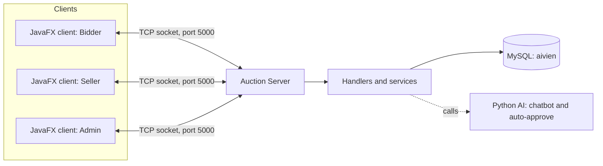

<div align="center">
# Auction System
 
**A real-time online auction platform built with JavaFX, Java sockets and MySQL, with an AI chatbot and ML-based auto-approval of auction requests.**
 


 
</div>
---
 
## Table of Contents
 
1. [Overview](#overview)
2. [Features](#features)
3. [Tech Stack](#tech-stack)
4. [Architecture](#architecture)
5. [Repository Structure](#repository-structure)
6. [Getting Started](#getting-started)
7. [Configuration](#configuration)
8. [Running the Application](#running-the-application)
9. [Business Rules](#business-rules)
10. [Troubleshooting](#troubleshooting)
11. [Documentation & Demo](#documentation--demo)
12. [Authors](#authors)
13. [License](#license)
14. [References](#references)
---
 
## Overview
 
Auction System is a university project for the *Advanced Programming* course (Object-Oriented Design). It simulates a complete online auction: sellers create auction sessions, an admin (or an ML model) approves them, bidders join auction rooms and place bids in real time, and the server closes each session and settles the money automatically.
 
| Part | Technology | Responsibility |
|---|---|---|
| **Client** | JavaFX 25, FXML, CSS | Login, lobby, auction room, dashboards |
| **Server** | Java sockets (port 5000), HikariCP, DAO layer | Business logic, bidding, timers, broadcasting |
| **Database** | MySQL 8.0+ (`aivien`), SQL schema script | Persistent storage of users, items, auctions, bids, transactions |
| **AI** | Python, scikit-learn | Support chatbot and logistic-regression auto-approval |
 
The guiding principle of the whole system is: **the client displays and sends requests; the server validates, decides and broadcasts.** The server is the single source of truth.
 
## Features
 
### Everyone
- Registration, login and logout
- Forgot-password flow with e-mail reset
- Personal account management
- Transaction history
- AI chatbot that answers usage questions
### Seller
- Browse products
- Create an auction session (submitted for approval)
- View active and finished sessions
- Close a session manually
- View history of created sessions
### Bidder
- Browse running auctions, with filtering and search
- View item and session details
- Join an auction room
- Place bids in real time, or configure **auto-bid**
- See the current highest bid and leader
- View own bid history and won auctions
### Admin
- Review pending auction requests; approve or reject them
- Manage users (view, suspend, activate) and products
- Cancel a session when needed
- View statistics reports and the **audit log**
### Technical
- Thread-safe concurrent access to auction state
- **Anti-sniping:** automatic extension when a valid bid arrives in the last 30 seconds
- Automatic session closing and money settlement
- Rooms close automatically and users return to the lobby when a session ends
- **ML auto-approve** of auction requests (logistic regression)
- Authentication and role-based authorisation
- Password hashing with **BCrypt** (cost 12)
- Rate limiting against request spam
- E-mail notification for password reset
- Connection pooling with **HikariCP**
- Logging with SLF4J + Logback
## Tech Stack
 
| Layer | Technologies |
|---|---|
| **Language** | Java 25, Python 3.8+, SQL, CSS |
| **Client UI** | JavaFX 25, FXML, CSS styling |
| **Networking** | Java Socket (TCP, server port 5000), custom message protocol (DTOs shared via `auction-common`) |
| **Database** | MySQL 8.0+, JDBC, HikariCP connection pool, DAO pattern, SQL schema script |
| **Security** | BCrypt password hashing, role-based access control, rate limiting |
| **AI / ML** | Python chatbot, scikit-learn logistic-regression model (`auction_model.pkl`) |
| **Build** | Maven (multi-module, wrapper included) |
| **Logging** | SLF4J + Logback |
| **Design tools** | StarUML class diagrams, PlantUML overview |
 
GitHub language breakdown: Java 85.5 %, Python 8 %, CSS 6.5 %. The SQL schema lives in `init_db.sql`.
 
## Architecture
 

 
Request flow (the rule to preserve when changing code):
 
```text
UI → Controller → Message → Router → Handler → State → Response → UI
```
 
The project is split into three Maven modules plus the AI folder:
 
| Module | Role |
|---|---|
| `auction-common` | Models, DTOs and messages shared by client and server |
| `auction-server` | Socket server, handlers, services, DAOs, configuration, AI integration |
| `auction-client` | JavaFX application: controllers, FXML views, CSS, session and network code |
| `Auction_AI` | Python chatbot and auto-approve model training and inference |
 
## Repository Structure
 
```text
Auction-System-OOD/
├── pom.xml                                 # Parent POM (multi-module)
├── README.md
├── DATABASE_SCHEMA_AND_DAO_GUIDE.md        # Database schema and DAO guide
├── auction_system_functions.json
├── auction-common/
│   └── src/main/java/com/auction/common/
│       ├── dto/                            # Message, AuctionEndNotificationPayload, AutoBidRequest, ...
│       ├── model/                          # User, AuctionRoom, Item, ...
│       └── role/                           # UserRole
├── auction-server/
│   └── src/main/
│       ├── java/com/auction/server/
│       │   ├── main/AuctionServer.java     # Entry point (port 5000)
│       │   ├── handler/  network/  service/  dao/  config/  AI/  utils/
│       └── resources/
│           ├── application.properties      # Database configuration
│           ├── logback.xml
│           └── database/init_db.sql        # MySQL schema
├── auction-client/
│   └── src/main/
│       ├── java/com/auction/client/
│       │   ├── app/  core/  feature/  network/  service/  session/
│       └── resources/                      # fxml/  css/  images/  logback.xml
├── Auction_AI/
│   ├── ChatBot/                            # chatbot.py, requirements.txt, README.md
│   └── AutoApprove/                        # train_logistic_regression.py, auction_model.pkl, Training_Data.csv
├── release/
│   ├── auction-server.jar
│   ├── auction-client.jar
│   └── client.properties                   # Client configuration
├── AuctionSystem_AllClasses_StarUML_Final.mdj
└── system-overview.puml
```
 
## Getting Started
 
### Prerequisites
 
| Tool | Version | Used for |
|---|---|---|
| **JDK** | 25 (JDK 17+ may work, but the project is developed on 25) | Compile and run JavaFX 25 |
| **Maven** | 3.6+ (or the included `mvnw`) | Build |
| **MySQL** | 8.0+ | Database |
| **Python** | 3.8+ (3.10+ recommended) | Chatbot and auto-approve |
| **Git** | any recent | Clone the repository |
 
Verify the installation:
 
```bash
java --version && javac --version
mvn --version
python --version
git --version
```
 
### Installation
 
```bash
# 1. Clone the repository
git clone https://github.com/25023189-bit/Auction-System-OOD.git
cd Auction-System-OOD
 
# 2. Create the database
mysql -u root -p -e "CREATE DATABASE aivien;"
 
# 3. Import the schema
mysql -u root -p aivien < auction-server/src/main/resources/database/init_db.sql
 
# 4. Set up the Python environment for the AI modules
cd Auction_AI
python -m venv .venv
source .venv/bin/activate          # Windows PowerShell: .venv\Scripts\Activate.ps1
pip install -r ChatBot/requirements.txt
cd ..
 
# 5. Build all modules
mvn clean package -DskipTests
```
 
## Configuration
 
### Server: database
 
Create or edit `auction-server/src/main/resources/application.properties` with your MySQL credentials. The database name used by the project is `aivien`. See [`DATABASE_SCHEMA_AND_DAO_GUIDE.md`](./DATABASE_SCHEMA_AND_DAO_GUIDE.md) for the schema and DAO details.
 
### Client: server address
 
The client reads `client.properties` (shipped in `release/`, or under the client resources):
 
```properties
server.host=localhost
server.port=5000
```
 
| Setup | `server.host` |
|---|---|
| Client and server on the same machine | `localhost` |
| Client on another machine in the same LAN | the server machine's IPv4 address (for example `192.168.1.10`, found with `ipconfig`) |
 
`server.port` must match the port the server listens on (5000 in the server entry point).
 
## Running the Application
 
> **Always start the server first.** The client needs the server for login, rooms and bidding.
 
### 1. Start the server
 
```bash
# Option A: Maven
mvn -pl auction-server exec:java
 
# Option B: executable JAR
java -jar release/auction-server.jar
```
 
Keep this terminal open while testing. Stop it with `Ctrl + C`.
 
### 2. Start one or more clients
 
In a new terminal at the project root:
 
```bash
# Option A: Maven
mvn -pl auction-client javafx:run
 
# Option B: executable JAR
java -jar release/auction-client.jar
```
 
### 3. Test a full auction
 
1. Open two or more clients and sign in with different accounts.
2. As **seller**, create an auction session.
3. As **admin**, approve the request (or let the AI auto-approve it).
4. As **bidders**, join the room and place bids; watch the price update on every client.
5. Let the timer run out (or close the session) and check the result.
Minimum regression path: `Login → Lobby → Create/approve session → Join room → Bid → Real-time update → Session ends`.
 
## Business Rules
 
### Core principles
 
1. The client displays and sends requests.
2. The server validates, decides and broadcasts; **server state is the source of truth**.
3. `auction-common` keeps models and messages identical on both sides.
4. AI only assists; it never replaces mandatory server-side checks.
5. Every role may do only what its role allows, and the server re-checks permissions on every request (hiding a button is not enough).
### Roles
 
| Role | Main permissions |
|---|---|
| **Bidder** | Browse auctions, join rooms, bid, use auto-bid, follow history and remaining time |
| **Seller** | Create auction requests, manage own sessions, follow session status |
| **Admin** | Approve or reject sessions, manage users and products, close or cancel sessions, view reports |
 
### Auction lifecycle
 
```text
Request created → Pending approval → Running → Ended
```
 
- Only valid, approved sessions are shown to bidders.
- An ended session accepts no new bids and no new auto-bids; the server rejects any such request.
- Status changes are broadcast to every client concerned.
### Creating a session
 
A request needs the item name, description, category, starting price, start time and end time (plus optional image, bid step and anti-sniping settings). The end time must be after the start time and the starting price must be a valid number. Sellers manage only their own sessions. When AI auto-approve is used, its output is advisory input to the server logic, and the server decides how to use it.
 
### Bidding
 
A bid is valid only if all of the following hold: the session is running; the user may bid in it; the amount is a valid number greater than the current price and meets the minimum step; the bidder has sufficient funds; the session has not been closed or expired.
 
On a valid bid the server updates the price and the leader, records the bid, and broadcasts to the room. On an invalid bid the server rejects it and the state is unchanged.
 
### Anti-sniping
 
A valid bid in the final window (30 seconds) extends the session. The extension is limited, applied only by the server, and the new end time is broadcast to the room.
 
### Auto-bid
 
A bidder sets a maximum price and an increment. Auto-bids obey every normal bidding rule, never exceed the configured maximum, and are triggered only by the server. Cancelling removes the configuration on the server; the client updates its UI only after the server confirms.
 
### Ending a session
 
A session ends when time runs out, the seller or admin closes it, or the system closes it. The server determines the winner (the highest valid bid, or no winner if there were no bids), processes the money, closes the room and returns users to the lobby.
 
### Chatbot and AI
 
- The chatbot explains how to use the application (login, browsing, joining a room, bidding, auto-bid, status and balance). It must not reveal internal protocol details, explain how to fake bids or edit the database, or make business decisions.
- AI auto-approve receives structured input and returns structured output. It never changes, creates or deletes sessions on its own, and the system needs a fallback when the AI fails.
### Money
 
All balance changes happen on the server; the client may show the balance but never decides whether a bid is affordable.
 
### Rules to keep when changing code
 
- Do not rename message types without updating client, server and common.
- Do not delete a handler before checking whether the router still calls it.
- Do not change `fx:id` or `onAction` in FXML while a controller uses them.
- Do not change backend logic only to suit a UI change.
- Keep multi-client support and the bidder / seller / admin flows working.
## Troubleshooting
 
Check in this order: environment → build → server → client → AI → network.
 
| Problem | Likely cause | Fix |
|---|---|---|
| `java`, `mvn`, `python` or `git` not recognised | Tool missing or not on `PATH` | Install it (a **JDK**, not only a JRE) and verify with `--version` |
| `BUILD FAILURE` | Wrong directory, wrong JDK, missing dependency | Run from the folder containing the root `pom.xml`, check `java --version`, retry `mvn clean package -DskipTests` |
| `Address already in use` | An old server still holds the port | Windows: `Get-Process java \| Stop-Process -Force`, then restart the server |
| Client cannot connect | Server not running, wrong `server.host` / `server.port`, firewall, different network | Start the server first, check `client.properties`, allow Java through the firewall |
| Old behaviour after a code change | Stale JAR or a leftover server process | Kill all Java processes, rebuild with `mvn clean package -DskipTests`, run the new JAR |
| `LoadException` / `Missing expression` / `Location is not set` | Wrong FXML path or syntax, missing `fx:id` or `onAction` method | Read the file and line in the stack trace, check the controller and resource path |
| Images or CSS missing | Resource path wrong or not under `src/main/resources` | Fix the path (case-sensitive) and rebuild |
| Login fails | Server down, wrong credentials, database not running or misconfigured | Check server log, MySQL service and `application.properties` |
| Wrong screen for a role | Server returned the wrong role, stale session | Log out and in, check the role in the login response |
| No auctions in the lobby | None created or approved, not started yet, already ended | Create as seller, approve as admin, check times |
| Cannot join a room or bid | Session not active, bid too low, insufficient balance, wrong role | Check status, remaining time and server log |
| Prices not updating between clients | Server does not broadcast to the room, clients in different rooms | Open two clients in one room and check broadcast and `Platform.runLater` |
| Auto-bid not working or not cancelling | Max price too low, cancel request not sent, stale server | Check the server log, cancel by `userId`, restart the server |
| Session does not end on time | Server timer not running | Check the scheduler and server clock, broadcast of the end event |
| Chatbot or auto-approve not responding | Python or libraries missing, wrong script or JSON path, model file missing | Activate the virtual environment, `pip install -r requirements.txt`, run the script manually, check `auction_model.pkl` |
| UI frozen | Update from a background thread, no response from server | Use `Platform.runLater`, make sure the server answers success **and** failure |
| Merge conflicts after `git pull` | Conflicting edits | `git status`, resolve the `<<<<<<<` blocks, `git add .`, commit |
 
Clean restart on Windows:
 
```powershell
Get-Process java | Stop-Process -Force
mvn clean package -DskipTests
java -jar release\auction-server.jar
```
 
## Documentation & Demo
 
- [Project report (PDF)](https://drive.google.com/drive/folders/1h1dDZL0z_v0DlvvriZxQpq55o1cZbCIU)
- [Database schema and DAO guide](./DATABASE_SCHEMA_AND_DAO_GUIDE.md)
- [Class diagram images](https://drive.google.com/drive/folders/1N_xzXZ_c1i6-L7C3Bl-t3bsYXWSXIsf2)
- [Demo video](https://drive.google.com/file/d/1jm25PCK1x3LAd_zeir_PhlkSpqa3lszx/view)
## Authors
 
| Author | Responsibilities |
|---|---|
| **Nguyễn Hữu Hùng** | Login, registration, AI chatbot, session creation, balance changes, bidding, session ending, admin permissions |
| **Tô Bảo Hân** | Network programming, server handling, multithreading, system state management, source-code management |
| **Bùi Thế Dũng** | Database design (`aivien`), database connectivity, password recovery by e-mail, testing and debugging |
| **Đặng Đức Anh** | JavaFX UI/UX (login, lobby, room, dashboards) and interface design |
 
Course: Advanced Programming, Object-Oriented Design.
Repository: [25023189-bit/Auction-System-OOD](https://github.com/25023189-bit/Auction-System-OOD)
 
## License
 
This project is part of a university assignment. All rights reserved.
 
## References
 
Ideas and design inspiration came from existing auction and commerce platforms:
 
- Auction platforms: [BPI Auctions](https://www.bpiauctions.com/), [Namecheap](https://www.namecheap.com/), [DGTS (Ministry of Justice, Vietnam)](https://dgts.moj.gov.vn/), [Dau Gia Viet](https://daugiaviet.vn/home), [eBay](https://www.ebay.com/), [Catawiki](https://www.catawiki.com/en), [DealDash](https://www.dealdash.com/)
- Social and commerce: Facebook, TikTok, Instagram, Amazon
 
